  

  
  
  
  
  

  Scrivo programmi per Windows che si scaricano, si aprono e funzionano: un installer o un solo <code>.exe</code>, 
  una guida passo passo in italiano, niente abbonamenti. Il codice di ognuno è qui, aperto.

 

## Progetti

**[ClipTale](https://github.com/Vincisus/ClipTale)** · Da un'idea in una riga a video pronti per YouTube e TikTok: storia, voce, disegni e montaggio, tutto sul tuo PC.
 Python · FastAPI · FFmpeg &nbsp;·&nbsp; [**Scarica per Windows**](https://github.com/Vincisus/ClipTale/releases/latest)

 

**[MicroMonitor](https://github.com/Vincisus/MicroMonitor)** · Uso e temperatura di CPU e GPU, e la RAM, in due righe nella barra delle applicazioni.
 C# · .NET 8 · LibreHardwareMonitor &nbsp;·&nbsp; [**Scarica MicroMonitor.exe**](https://github.com/Vincisus/MicroMonitor/releases/latest/download/MicroMonitor.exe)

 

## Come lavoro

- **Prima chi lo usa.** Ogni progetto ha un README in italiano che porta dal download al primo avvio, con le immagini vere dell'app.
- **Sul tuo PC.** Le app lavorano in locale quando possono; i servizi online sono una scelta, mai un obbligo.
- **Gratis e aperto.** Niente pubblicità, niente abbonamenti, il codice da leggere e da migliorare.

Hai trovato un bug o hai un'idea? Apri una *Issue* nel progetto giusto.

 

## Sostieni

Tutti i progetti sono gratis e restano gratis. Se uno ti fa risparmiare tempo, puoi offrirmi un caffè.

  

